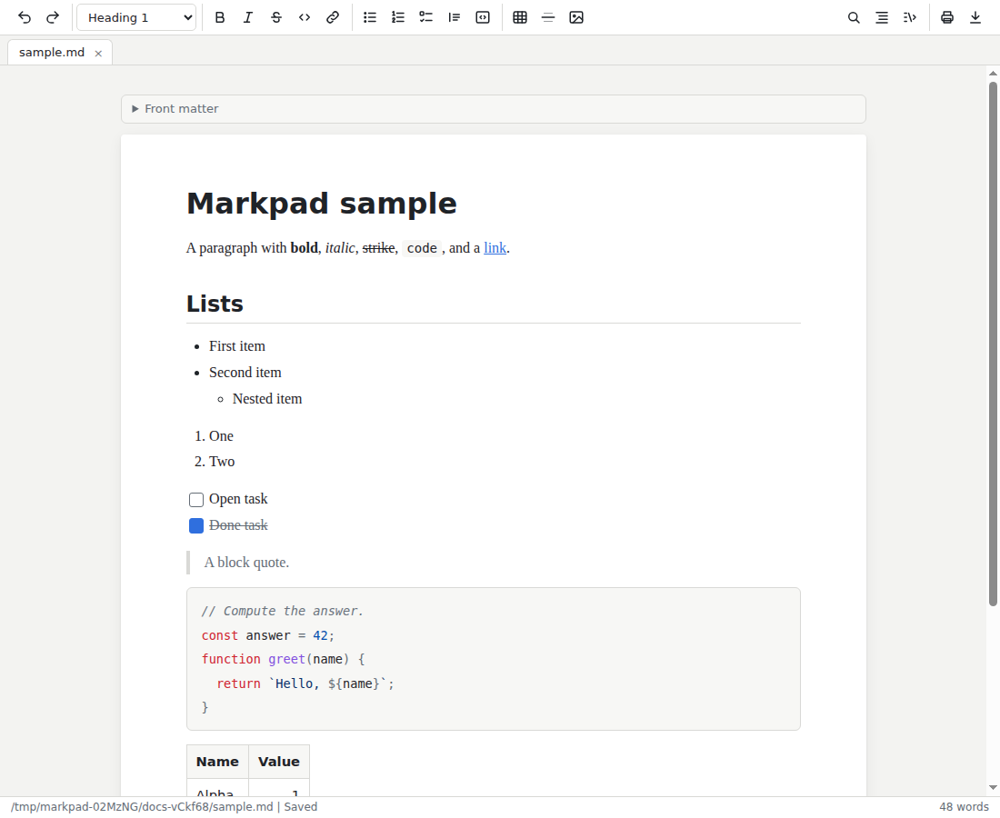

# Markpad

Markpad is a lightweight desktop editor for Markdown files. It opens a file
in a styled, editable view, like a small word processor, and saves the file
as Markdown. It runs on Linux, Windows, and macOS.



## Install

Download Markpad from the
[latest release](https://github.com/GITHUB_USER/Markpad/releases/latest).

- **Debian, Ubuntu, and other Debian-based Linux**: Download the
  `markpad_VERSION_amd64.deb` file and install it:

  ```
  sudo apt install ./markpad_VERSION_amd64.deb
  ```

  Replace `VERSION` with the version you downloaded, such as `1.0.0`.

- **Other Linux distributions**: Download the `Markpad-VERSION.AppImage`
  file, make it executable with `chmod +x Markpad-VERSION.AppImage`, and
  run it.

- **Windows**: Download and run the `Markpad-Setup-VERSION.exe` installer.

- **macOS**: Download the `Markpad-VERSION-arm64.dmg` disk image for Apple
  silicon or `Markpad-VERSION-x64.dmg` for Intel, open it, and drag
  **Markpad** to the **Applications** folder.

If a release doesn't list an installer for your system yet, you can build
one from source. For instructions, see [Build Markpad installers](BUILDING.md).
The installers aren't code-signed, so Windows and macOS warn the first time
you open Markpad; that guide also explains how to open it anyway.

Markpad doesn't update itself. To update, install the newer release.

## Features

- **Styled editing**: Type Markdown syntax, such as `**bold**`, `# `, or
  `- `, and it turns into formatting as you type. A toolbar applies the same
  formatting.
- **Tabs and autosave**: Open several files in tabs. Markpad saves each
  file one second after you stop typing, and reopens your tabs at the next
  launch. Untitled documents stay in a drafts folder until you save them as
  a file.
- **Your file's style**: Markpad writes back only what you edit. Unedited
  parts of a file keep their exact text, and edited parts follow the
  file's own conventions, such as `*` or `-` bullets.
- **GitHub Flavored Markdown**: Tables, task lists, and strikethrough.
- **Code**: Syntax highlighting for common languages.
- **Images**: Local images by relative path. Pasted or dropped images are
  copied into an `assets` folder next to the file.
- **Source view**: Switch to the raw Markdown at any time.
- **Find and replace**, an **outline** of the headings, and **spell check**.
- **Print and export**: The **Print** and **Download as PDF** buttons at the
  right end of the toolbar print the styled document or save it as a PDF.
  You can also export to a standalone HTML page from **File > Export**.
- **Copy as HTML**: To paste formatted text into an email, right-click and
  choose **Copy as HTML**. Without a selection, it copies the whole
  document. The copy uses inline styles and the light theme, and embeds
  local images.
- **Front matter**: Edit a file's YAML front matter in a panel above the
  document.
- **Light and dark themes**: Follow the OS, or choose one in **View > Theme**.

## Open files from a terminal

The `mdv` command opens files in Markpad, the way `subl` does for Sublime
Text. Each file opens as a tab in the running window, and the command
returns to the prompt right away:

```
mdv notes.md docs/plan.md
```

A file that doesn't exist opens as an empty document, and Markpad creates
it when you type. Run `mdv --help` for the options.

To set up the command, do one of the following:

- **Debian package**: Installing the `.deb` package adds `/usr/bin/mdv`.
- **AppImage, macOS, or Windows**: Click **Help > Install 'mdv' command**.
  - On Linux, the command goes in the `~/.local/bin` folder, which must be
    on your PATH.
  - On macOS, it goes in the `/usr/local/bin` folder; macOS asks for your
    password.
  - On Windows, it goes in `%LOCALAPPDATA%\Markpad\bin`, and Markpad adds
    that folder to your user PATH. Open a new terminal to use it.

To remove the command, click **Help > Remove 'mdv' command**, or uninstall
the Debian package.

## Keyboard shortcuts

On macOS, use Cmd in place of Ctrl.

| Action               | Shortcut         |
|----------------------|------------------|
| New document         | Ctrl+N           |
| Open                 | Ctrl+O           |
| Save as              | Ctrl+Shift+S     |
| Close tab            | Ctrl+W           |
| Next or previous tab | Ctrl+Tab, Ctrl+Shift+Tab |
| Bold, italic         | Ctrl+B, Ctrl+I   |
| Inline code          | Ctrl+E           |
| Strikethrough        | Ctrl+Alt+X       |
| Link                 | Ctrl+K           |
| Open a link          | Ctrl+click       |
| Copy as HTML         | Ctrl+Shift+C     |
| Print                | Ctrl+P           |
| Find, replace        | Ctrl+F, Ctrl+H   |
| Markdown source      | Ctrl+/           |
| Outline              | Ctrl+Shift+O     |

## Known limitations

- Save As to another folder doesn't copy the document's images, so
  relative image paths can break. Untitled documents move their images
  correctly when you first save them.
- Raw HTML in a Markdown file shows as text, not as rendered HTML.
- Switching out of the Markdown source view clears the undo history.
- Very large files, with thousands of paragraphs, are slower to open.
- The installers aren't code-signed, so Windows SmartScreen and macOS
  Gatekeeper warn the first time you open Markpad.

## Build and develop

To set up a development environment and run the tests, see
[Contribute to Markpad](CONTRIBUTING.md). To build installers, see
[Build Markpad installers](BUILDING.md).

## License

Markpad is released under the [MIT License](LICENSE).
